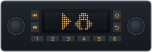
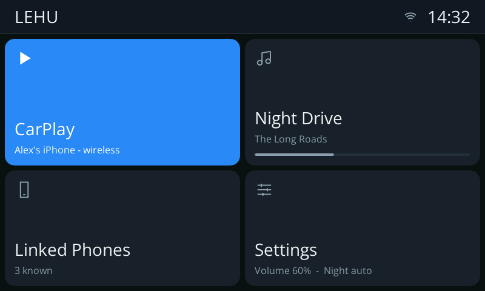
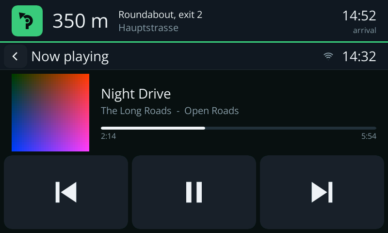
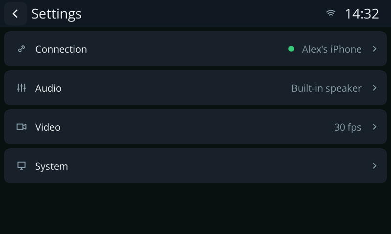
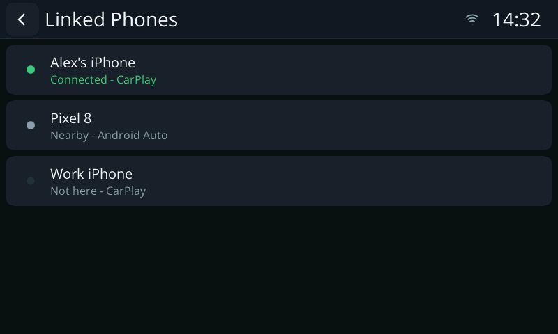
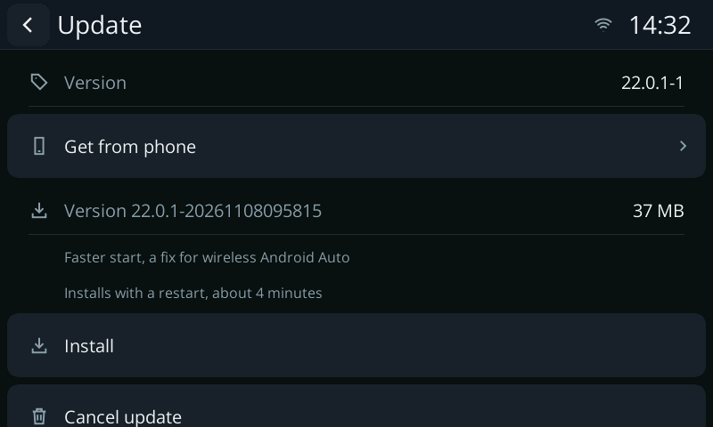
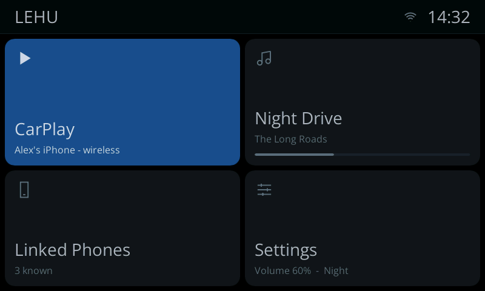

  

  <b>A lightweight embedded head unit for Linux.</b>

  
  
  

---

LEHU turns a small Linux board with a touchscreen into a car head unit. It
runs Apple CarPlay and Android Auto over USB or Wi-Fi, decodes the phone's
video in hardware, mixes its audio, and brings its own screens for
settings, phones, Bluetooth, the reversing camera and media. Everything can
be done with the touch panel alone, or with a rotary knob alone.

## Built for the F1C200s

LEHU is developed and tested on the **Allwinner F1C200s**, one of the
smallest chips that can run a head unit. That board sets the minimum
requirements: if LEHU runs well there, it runs on almost anything with
Linux.

| | Allwinner F1C200s |
|---|---|
| CPU | one ARM926EJ-S core, 408 MHz nominal, no FPU, no SIMD |
| Memory | 64 MB DDR, on the chip |
| Graphics | none: the screens are rendered in software |
| Video | cedrus H.264 decoder, display engine with hardware scaling |
| Display | 800 × 480 over DRM/KMS |

## Features

- **CarPlay**: wired and wireless, with CarPlay Ultra on an MFi 3.0
  coprocessor.
- **Android Auto**: wired and wireless.
- **Phones**: every link listens at once, and a phone on the cable comes
  first. Known phones are remembered, to connect, stop or forget.
- **Calls and voice assistants**, with the microphone back to the phone.
- **Now playing** with album art, and **turn-by-turn** guidance on the
  head unit's own screens.
- **Audio**: a fixed-point mixer with per-stream levels, a jitter buffer
  for music over Wi-Fi, and ducking for voice.
- **Controls**: the whole head unit works by touch alone or by a rotary
  knob alone; Bluetooth keyboards and remotes work too.
- **Reversing camera** on the composite input, with a key to switch to
  it.
- **Day and night** palettes, and settings that apply as they change.

## Screenshots

| | | |
|:-:|:-:|:-:|
|  |  |  |
| Home | Now playing and navigation | Settings |
|  |  |  |
| Linked Phones | Update | Night |

## Requirements

- Linux with DRM/KMS and a display with an overlay plane.
- A V4L2 stateless (request API) video decoder, driven through ffmpeg's
  v4l2-request support (ffmpeg 6.1 or 8.x).
- ALSA, OpenSSL, libopus; BlueZ and hostapd for wireless phones.
- An Apple MFi authentication coprocessor on I²C, for CarPlay.

What a board image must provide in detail (users, device access,
real-time priority, BlueZ and hostapd) is in
[docs/image-requirements.md](docs/image-requirements.md).

## Documentation

| | |
|---|---|
| [User guide](docs/user-guide.md) | the screens, the controls, phones and Bluetooth devices |
| [CarPlay Ultra](docs/carplay-ultra.md) | what it adds, themes, and how to check it |
| [Install on a Raspberry Pi](packaging/debian/README.md) | the apt repository, starting at login, setup |
| [Building](docs/building.md) | the F1C200s, Raspberry Pi and x86 builds, packages, tests, on-board tools |
| [Packaging](packaging) | Buildroot external tree, Yocto layer, Debian packaging |
| [Image requirements](docs/image-requirements.md) | what a board image must provide |
| [Architecture](docs/architecture.md) | design principles, crates, sessions, video and screens |
| [Roadmap](docs/ROADMAP.md) | plans for future |

## Credits

LEHU stands on the work of other open-source projects. Thank you to their
authors and contributors.

- **[FastCarPlay](https://github.com/niellun/FastCarPlay)** by Niellun and
  contributors, and its F1C200s port: LEHU is its rewrite in Rust and keeps
  its designs for the protocols, the audio mixer, the video path and the
  screens.
- **[LIVI](https://github.com/f-io/LIVI)** by Lasse Heitgres, a Rust
  CarPlay and Android Auto host: LEHU's CarPlay stack follows LIVI's file
  by file, as FastCarPlay's native backend did before it: the pairing, the
  control channel, the info plist, iAP2 and usbmux, now playing and route
  guidance, album art, CarPlay Ultra's MFi 4 authentication and vehicle
  state. On the Android Auto side the accessory switch, the opening of its
  pipe and the status definitions are LIVI's. LEHU would not exist in this
  form without it. Many thanks to the LIVI project.
- **[Slint](https://slint.dev)** for the UI toolkit (GPL-3.0), the
  **Linebender** project's fontique and parley for text, and **Open Sans**
  (SIL Open Font License 1.1) for the font.

[NOTICE](NOTICE) names the files each of these reached;
[THIRD-PARTY.md](THIRD-PARTY.md) lists every crate in the binary with its
licence and copyright notices.

## License

GPL-3.0-or-later. See [LICENSE](LICENSE). The binary links Slint under
GPL-3.0-only, so binaries are distributed under GPL version 3.
