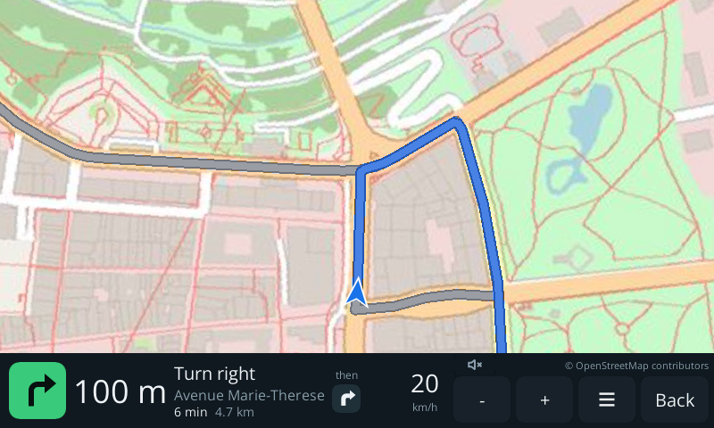
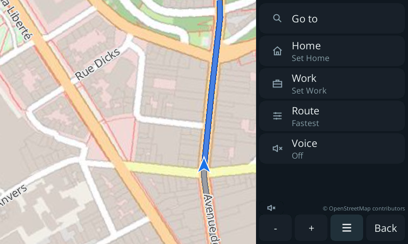
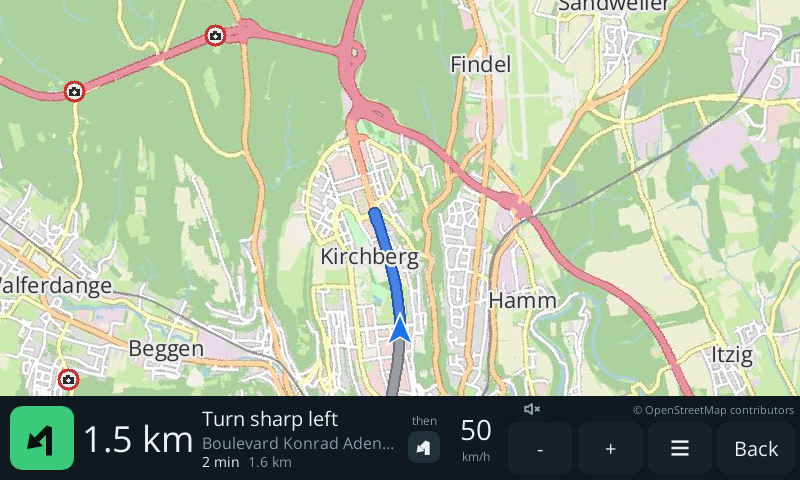
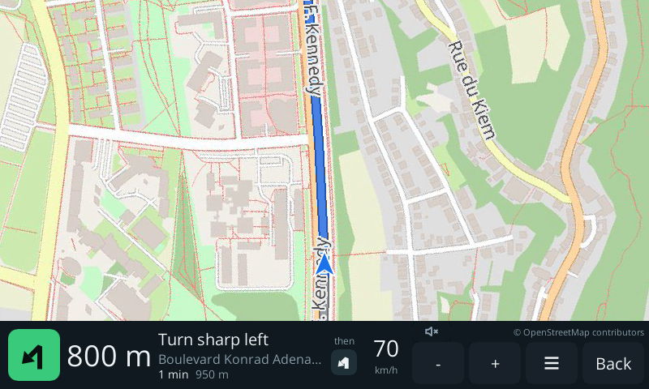
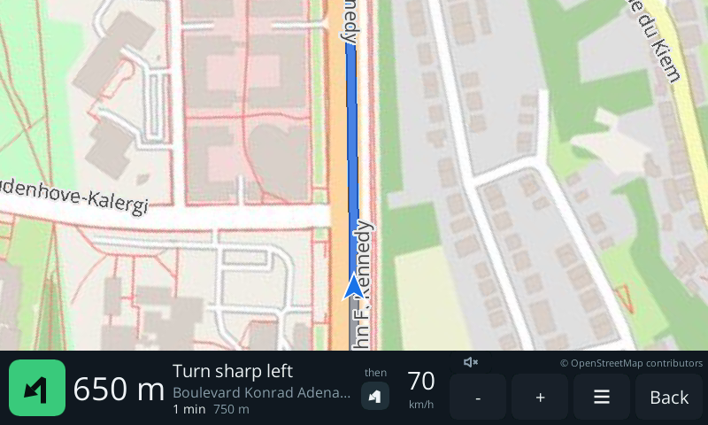
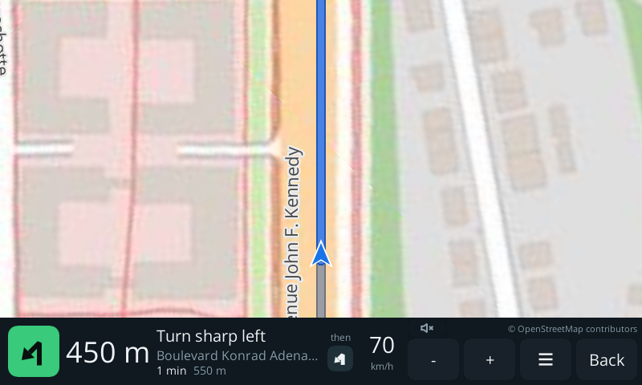
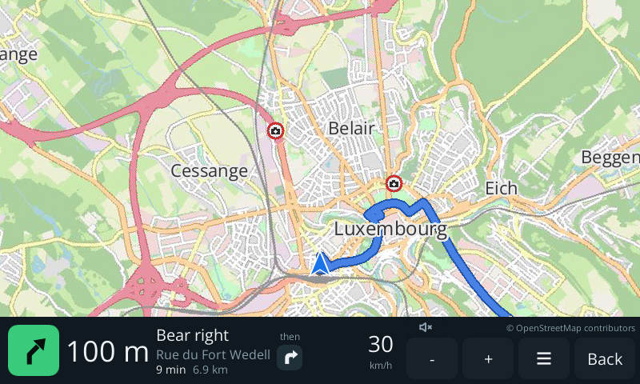

# The offline map

Home > Map shows an OpenStreetMap map from the SD card, with no phone and
no internet. It scrolls and zooms, finds a destination by name (or the
nearest fuel, parking or charging) and the fastest or shortest route
there, and guides along it with spoken prompts. There is no GPS yet: the
position is a stand-in (see [Where we are](#where-we-are)), and a route
found is driven by itself from there, as a replayed drive is.



## Controls

Everything works with the knob alone and with touch alone, the same way.
The bar's keys never move: at its right end `-`, `+`, the menu key and
Back; just left of them a Me key while the map has been moved off where
we are, and a muted key left of that while the spoken prompts are off.
The rest of the bar is words: the map's name and zoom, or, while it
guides, the next turn. Only while a route just found is shown whole do
Start and Cancel take the keys' place ([below](#the-whole-route-first)).

| Input | What it does |
|---|---|
| Drag | moves the map with the finger |
| Arrow keys | move it a quarter of the screen |
| Knob turn, or the bar's - and + | zoom out and in |
| Knob click, or the bar's menu key | open the map's menu |
| Back, or the bar's Back key | leave the map |
| The bar's Me key, there while the map is off where we are | centre on where we are, and follow it |
| The bar's muted key, there while the voice is off | the spoken prompts on again |



The map's menu is a column at the right, over the map, the bar's keys at
its foot. Its rows, those that apply:

| Row | What it does |
|---|---|
| My position | as the Me key, while the map is off where we are |
| Stop route | ends a route found on the head unit |
| Go to | find a destination and drive there ([below](#going-somewhere)) |
| Home, Work | drive there at once; under the name, the place and how far. Not set yet: choose it (below) |
| Route | how routes go, under it what is chosen ("Fastest", "Shortest, no motorways"): opens its choices ([below](#route-options)) |
| Voice | the spoken prompts on or off (`map.voice`); the menu stays open |

With the knob the ring starts on the first row: turning moves it (round at
the ends), a click chooses, Back closes the menu (a second Back leaves the
map). A tap chooses a row; a tap on the map beside the menu, or the menu
key again, closes it, and it closes by itself eight seconds after it was
last used. Go to, Home, Work and Route need the road data; without it the
menu has only what is left.

LEHU opens the map where it was left, or on where we are when it knows.

## Zoom

The - and + keys (or the knob) choose the zoom, 8 to 16 for a region
built as [below](#making-a-map); past the deepest tiles the map enlarges
them. Following a drive, the zoom goes with the speed: below 60 km/h a
level closer than the zoom chosen, above 100 km/h a level further out to
see further ahead, between them the zoom chosen, and a level closer again
within 250 m of a turn. A change of zoom is shown smoothly, the map
growing or shrinking about the arrow.

| | |
|:-:|:-:|
|  |  |
| Zoom 12 | Zoom 14 |
|  |  |
| Zoom 15 | Zoom 16 |

## Where we are

There is no GPS receiver yet. For testing, `map.fake-position` in the
settings gives a position, "latitude, longitude" in degrees:

```toml
[map]
fake-position = "49.6116, 6.1300"
```

The map then opens on it and shows it as a blue dot; once the map is
moved off it, the bar's Me key (and the menu's My position) centres the
map on it again.

A recorded drive can stand in for a moving position: `map.fake-track`
names a GPX file, which LEHU follows in real time, from the start again at
its end. The position is a blue arrow along the road, and the map follows
it until it is dragged; the Me key makes it follow again. While it
follows, the map turns so that the way ahead is up, with more road ahead
than behind. When the GPX has the route's turns as waypoints, the map
draws the route and guides along it: the bar shows the next turn, its
distance and the road it leads onto, the time of arrival, and the time
and distance left. The route already driven turns grey. Where the drive's
points carry the road's speed limit, the bar shows a limit sign beside
the speed, the speed in red when it is over.

`scripts/route-gpx.py` makes such a drive on a PC from the same extract as
the tiles: the fastest car route between two points, keeping to one-way
streets, timed at each road's speed, with its turns and the roads' speed
limits. The drive in the pictures here, from the station in Luxembourg
City to Kirchberg:

```sh
v/bin/python scripts/route-gpx.py luxembourg-latest.osm.pbf \
    49.6045,6.1300 49.6188,6.1440 drive.gpx --name "Gare to Kirchberg"
```

## Spoken prompts

While the map guides, LEHU says the turns: early, about half a minute
ahead ("In 500 metres, turn left" in town, "In 1 kilometre" on a
motorway), near, about ten seconds or 200 m ahead, and as the turn comes
("Now, turn left"; at a roundabout "Take the second exit"). Each is said
once. When a turn comes soon after the last, the prompts that no longer
fit are left out; when the next turn is closer than the near prompt's
distance, it is told with this one ("In 200 metres, turn left, then turn
right"). The destination is "You will reach your destination" ahead and
"You have arrived at your destination" there. Distances are spoken round:
50 m steps up to 250 m, 100 m steps up to 900 m, then 1, 1.5 and 2 km.

The prompts play through LEHU's own audio at the navigation level
(`audio.navigation-level`), ducking the music as the phone's voice does.
They do not talk over the phone: while a call, the phone's assistant or
its own navigation is speaking, a prompt waits for half a second of quiet,
and one that has waited a second and a half is dropped, since a turn
announced late is worse than one not announced. `map.voice = false` turns
them off, and so does the map menu's Voice row, at once.

A prompt is put together from clips, WAV files of a phrase each ("In 500
metres", "turn left", "then", "Take the second exit"), read from a voice's
folder as they are first needed. The card's map partition can hold many
voices, each in a folder of its own under `voice/`
([below](#data-on-the-card)): `/maps/voice/en_GB-cori-high`,
`/maps/voice/hu_HU-anna-medium`. Settings > Map > Voice steps through
them by name ("Cori, English, high"), with the knob or the - and + keys,
and Enter takes the one shown: it is `map.voice-dir` from then on. With
none chosen, LEHU speaks with `/maps/voice/en` when the card has it, else
the card's first English voice, else its first. The clips are not in the
system image: they are made on a PC and copied to the card. Without them
the map guides in silence, and Settings > Map says the voice is not
installed.

They are made on a PC by `scripts/voice-clips.py`, with
[Piper](https://github.com/OHF-voice/piper1-gpl), an offline speech
synthesizer, and a voice from its catalogue, in English, Hungarian,
German, French, Spanish, Italian or Turkish: the script has the phrases
in each, and the language is the voice's (`--lang` to say another). The
clips' names, and so the head unit, are the same in every language.
`en_GB-cori-high`, a British English voice, is in the public domain.
Nothing is installed system wide:

```sh
python3 -m venv voice-venv
voice-venv/bin/pip install piper-tts
voice-venv/bin/python -m piper.download_voices --data-dir voices en_GB-cori-high
voice-venv/bin/python scripts/voice-clips.py voices/en_GB-cori-high.onnx \
    voice/en_GB-cori-high --demo demo.wav
```

The script writes the forty-one clips, about 2.8 MB, into the folder:
16-bit mono PCM at 24 kHz, their silent ends trimmed and all at one
loudness. `--demo` also writes a few whole prompts, put together as the
board does, to hear on the PC. `tools/lehu-maps` does all this for each
voice ticked and writes each to the card with a `map.toml` naming it. By
hand, copy the folder to the card's map partition under `voice/`. A clip
that is missing is named once in the log, and the prompts that need it
stay silent. Routes found on the board are spoken the same way, and so is
the speed camera warning ("Speed camera ahead").

## Going somewhere

The menu's Go to, there when the map has the road network and the names
(see [Routing data](#routing-data)), opens the destination screen. It
opens on a list: the row to type a name, under it the nearest fuel,
parking and charging ([below](#fuel-parking-and-charging)), then the
destinations driven to last, one choice each. After a tap on the top row
(or a letter typed) it is a keyboard: type a few letters of a street or a
place, and the two best matches show over the keyboard, each with its
town and how far it is from here. A tap on one finds the route; the
keyboard's List key shows all the matches as rows (a knob or a remote
walks them, Enter takes one). Case and accents never matter, and every
word typed has to begin a word of the name or of its town: "gare" finds
Gare and Avenue de la Gare, "gare esch" the Rue de la Gare in
Esch-sur-Alzette. Places come before streets, and among equal matches the
nearest first. The words can come in any order, and the usual short forms
are written out.

A number typed with a street's words is a house number: the street's
houses whose number begins with it come first, named with it and their
postcode ("Rue de la Gare 57", "1611 Luxembourg"), then the street
itself. A letter after the number is part of it ("57 a" is 57/A), and
either number of a range finds it ("32" finds 30-32). A postcode typed
too keeps only its houses. A number the street does not have lists the
nearest one on the same side of the street, within 20 of it. The houses
are OpenStreetMap's addresses; a route to one goes to the road nearest it.
A search reads only the names that can match, so a key typed answers in
a few milliseconds on the head unit even over a country.

The route is found on the head unit, from where we are now (the replayed
drive's position, else `map.fake-position`, else the middle of the map) to
the nearest road to the destination: the fastest by car (or as the [route
options](#route-options) say), keeping to one-way streets and
roundabouts, timed at each road's speed. The screen says "Finding the
route" meanwhile, then goes back to the map, which shows the route whole
first ([below](#the-whole-route-first)), then guides along it: the route
line with the part driven grey, the next turn on the bar, closer in near
turns, the speed limit and the time of arrival. With a position from
elsewhere (a replayed drive, until the phone's), the route follows it
([below](#off-the-route)); without one, the route is driven by itself at
the roads' speeds, as a drive is replayed. Leaving the map and coming
back keeps it, driven on meanwhile, with its prompts, and the navigation
card of the other screens (Home, Now playing, Settings) shows its next
turn while the phone is not guiding. The menu's Stop route ends it, and
so does arriving: the bar (or the card) shows a flag, "Arrived" and the
destination for ten seconds, and "You have arrived at your destination" is
said. Where it ended is the position from then on (until LEHU restarts).
When there is no route, the screen says why.

When the turn after the next one comes within 300 m of it, the bar and
the card show it beside the next one, small, under "then", so both can be
prepared for at once.

### Off the route

A route followed by a position from elsewhere places each position on it:
on the road nearest it, near where the last one was, else anywhere on the
route (after a tunnel). The guidance, the prompts, the speed cameras and
the speed limit are then the route's at that place.

A position more than 40 m from the route for 5 seconds while moving is
off it: the driver took another road. The route is then found anew from
there, going the way the position goes (so not by turning round); the bar
says "Finding the route" meanwhile, the route left still shown, and the
new one is guided at once. Going the wrong way along the route counts
once it has lasted 8 seconds. Standing never counts: a position drifts at
a stop. Within 150 m of the destination nothing is found anew, the last
streets being the driver's choice, and within 50 m of it, from any side,
the destination is reached. A route found anew takes well under a second
on the board.

`cargo run --release -p lehu-map --example follow REGION DRIVE.gpx "LAT,
LON"` replays a drive against a route to a destination faster than real
time, as LEHU follows it, and prints each route found anew; a drive that
leaves the fastest route is made with `scripts/route-gpx.py --via`.

### The whole route first

A route to a destination chosen on Go to (a name, a recent one, the
nearest fuel...) is shown whole before it is driven: the map turns north
up and zooms to hold all of it above the bar, where we are and the route
drawn, and the bar shows the destination, its distance, how long it takes
and the time of arrival ("12 km · 14 min · arrival 14:46"). Its keys are
Start, where -, + and the menu key were, and Cancel, where Back was.

The knob's ring is on Start: a click starts, a turn moves the ring to
Cancel (and back), Back cancels. A tap on either does the same. Start
counts down ("Start in 5 s"): left alone for eight seconds, the route
starts by itself, so a driver never has to touch it; any key or a drag
starts the count again, and leaving the map starts it at once. Cancel
leaves the map as it was, a route driven before going on. Meanwhile a
drag or the arrows move the map round the route.

Home and Work from the menu, and a route found anew when the route
options change, are driven at once, without it.

### Home and Work

The menu's Home and Work drive there with one choice. Not set yet, the row
says "Set Home" and opens the destination screen, titled "Set Home", to
choose it as a destination is chosen; the place is kept (`map.home`,
`map.work`) and the bar says "Home set: ..." for a moment, without driving
there. To change them later, the destination screen's recent list ends
with Change Home and Change Work, for those that are set.

### Route options

The menu's Route row says how routes go ("Fastest", "Shortest, no
motorways"). Chosen, its choices take the menu's place: Fastest and
Shortest (a green dot on the one taken), Avoid motorways (on or off) and
Speed cameras ([below](#speed-cameras)). With the knob the ring starts on
Fastest; a click takes a row, and the menu stays; Back goes back to the
menu's rows. A tap takes a row too; the menu key, a tap beside the menu
or eight seconds left alone close it all. Once the choices are left, a
route being driven is found anew with them, from where we are.

The choices are kept in the settings:

```toml
[map]
route-by = "shortest"     # or "fastest", the default
avoid-motorways = true    # false by default
```

The shortest is the least distance, whatever the roads' speeds. Avoiding
motorways, a motorway or a motorway's link costs five times its time (or
its length), so the route takes another road wherever one goes the same
way in less than several times the time, and still takes the motorway
where nothing else goes.

### Fuel, parking and charging

Besides names, `places.bin` has the filling stations, the public car
parks and the charging stations of the extract. Go to's list has a row
of three under the search row, Fuel, Parking and Charging, those the data
has. One chosen lists the eight nearest of its kind to where we are in
the recent ones' place, the nearest first, each with its name and under
it a few words and how far: "Aral · 1.2 km", "Multi-storey, 400 spaces ·
350 m", "4 points, 22 kW · 2.1 km". One of them is picked as any
destination (the route shown whole, then driven). Back, or the same kind
chosen again, lists the recent ones again. They are not searched by name.

A car park is one anyone may use (not private, nor only a shop's
customers), not the side of a street, with a name or room for ten cars
or more; a charging station one for cars, not private. Luxembourg has
237 filling stations, 403 car parks and 531 charging stations.

### Speed cameras

With `map.speed-cameras = true` (the Route choices' Speed cameras row
switches it: Warn or Off), LEHU says "Speed camera ahead" once before
each fixed speed camera on the route (or, without one, on the road
ahead): twelve seconds of driving ahead of it, but no nearer than 300 m
and no further than 500 m. It is off by default: warning of speed cameras
is against the law in some countries (France, Germany and Switzerland
among them), so turn it on only where it is allowed. The spoken warning
needs the prompts on (`map.voice`). From 500 m before a camera the bar
shows a red camera sign and the distance to it, in 50 m steps, in the
place of the time of arrival, until it is passed; with the voice off too.



Without a route of ours (only where we are), the cameras are looked for
on the road ahead instead: the position is placed on the nearest road
going its way, and the road is followed for 800 m, at each junction on
into the road of the same name, else the one nearest straight on. Its
cameras that watch the way it goes are warned of as a route's are. A
camera within 100 m of one already warned of is not warned of again: a
gantry is often mapped twice, once for each carriageway.
`examples/lookout.rs` replays a GPX drive this way and prints each
warning.

While they are warned of, the map draws each camera from zoom 13 in
(further out a city's would crowd it): a red ring round a white disc with
a dark camera. The cameras are OpenStreetMap's (`highway=speed_camera`),
each taken to the nearest road within 50 m, watching the traffic its
enforcement relations or its `direction` say, else both ways. Luxembourg
has 39. They are in a file of their own, `cameras.bin`
([below](#routing-data)).

### Speed limit

Where the road's speed limit is known, the bar shows its sign beside the
speed, the speed in red when it is over. When the speed stays more than
5 km/h over it for 2 seconds, a short soft chime plays once, through the
same audio as the prompts; it chimes again only after the speed came back
to the limit, or on a road with another limit. `map.speed-warning =
false` turns the chime off.

### Routing data

`scripts/map-graph.py` writes the road network, the speed cameras and
the names from the same extract as the tiles, into three files:

```sh
v/bin/python scripts/map-graph.py luxembourg-latest.osm.pbf maps
```

| | Luxembourg |
|---|---|
| `roads.bin` | 7.0 MB: 63,000 junctions, 75,000 roads; 3,900 junctions of main roads |
| `cameras.bin` | 1 kB: 39 speed cameras |
| `places.bin` | 0.5 MB: 10,000 streets, 2,200 places, 1,200 filling stations, car parks and charging stations |
| on a PC | half a minute |

They go in the region's folder, beside `map.toml` (`scripts/map-region.py`
puts them there). `cameras.bin` is optional: without it, there are no
camera warnings and routes are found as before. It is tied to the
`roads.bin` it was placed on (by a build ID in both): the cameras change
far more often than the roads, so they can be replaced alone, as long as
they are placed on the same build; one placed on another is ignored, with
a line in the log. The roads and their speeds are the ones
`scripts/route-gpx.py` drives, so both find the same routes; only the
part of the network where every junction can be reached from every other
is kept, so a destination is never in a car park with no way out.

The files are mapped from the card and read in place rather than loaded,
so they cost the head unit page cache, not memory of its own. LEHU still
reads the earlier versions of each; a LEHU older than the data refuses
it and says so in the log. The layouts are in
[map-data-format.md](map-data-format.md).

### How routing works

The route is A* by time over the junctions, in integer arithmetic, with
a bound that never overestimates, so the route found is the fastest; the
shortest is the same search by distance. The start and the goal are taken
to the nearest point of the nearest road, and setting off against the way
the drive is going costs a U-turn's half minute. The turns are found as
`scripts/route-gpx.py` finds them: at a junction, a turn of 45 degrees or
more or a road with another name; into a roundabout, the exit to take.

Across a country that search would read most of the network, many
seconds on the board. So the main roads (motorways, trunk, primary and
secondary roads and their links) are also a smaller network of their own,
the layer: its junctions are where main roads meet, each of its roads the
run of main road from one such junction to the next, with what it costs
in each measure and the roads it is made of. The search runs on two
levels at once: near the start and near the goal (5 km, or further for a
short trip, so a trip in town is searched over every road) it takes every
road; further from both it follows the layer, a whole run of main road at
a step. The route found is the best of those that leave the main roads
only near either end, which is the best of all nearly always and within
a few per cent otherwise; when there is no such route, the search is made
again over every road. In Luxembourg the drive above (Gare to Kirchberg)
takes about 0.5 ms on a PC, Schengen to Troisvierges (112 km) 3 to 4 ms;
on the board, tens of times slower and reading the card, a long route
takes about a second. Before the first route the whole of `roads.bin` is
checked once, in the background when the map opens, so that nothing read
from it later can be out of range.

## Making a map

Most people get a region onto the card with the PC tool,
`tools/lehu-maps` ([below](#getting-maps-onto-the-card)), which does what
follows for them. By hand, a region is built on a PC from an
OpenStreetMap extract, for example one from
[Geofabrik](https://download.geofabrik.de), by one command:

```sh
python3 -m venv v && v/bin/pip install osmium pillow
v/bin/python scripts/map-region.py luxembourg-latest.osm.pbf luxembourg --preset luxembourg --workers 4
```

`scripts/map-region.py` writes the road data (`scripts/map-graph.py`),
draws the tiles and places the names (`scripts/map-tiles.py`), packs
them, and last writes the region's `map.toml`, into the folder
`luxembourg`, ready to copy to the card. `--only graph`, `--only tiles`
or `--only manifest` does one part. `--estimate` prints a rough size and
time and exits; `--progress` prints lines for a program running the
script. A preset says which zooms are drawn where: a whole country at the
deepest zooms would be far too large and take days, so they are drawn
only over towns.

| Preset | Zooms |
|---|---|
| `luxembourg` | 8-14 over the extract, 15-16 over Luxembourg City |
| `hungary` | 8-14 over the extract, 15-16 over Budapest and every city or town of 50,000 people or more |
| `auto` | 8-14 over the extract, 15-16 round every place tagged city or town with 50,000 people or more |

Luxembourg takes about three and a half minutes on two cores and makes
33.8 MB: the tiles 26.3 MB (4,289 tiles), the names 0.3 MB, the road data
7.2 MB.

`scripts/map-tiles.py` can also be run alone. It writes
`<out>/<z>/<x>/<y>.jpg` (256 x 256 baseline JPEGs) and `<out>/map.toml`;
`--area Z0-Z1:W,S,E,N` draws more zooms over a smaller area in the same
run, and `--pack [DEST]` packs the tiles into `DEST/tiles.pmtiles` and
the names into `DEST/labels.pack`. A folder of loose tiles still works as
a map.

The tiles are drawn by the script, never fetched from OpenStreetMap's tile
servers: their usage policy forbids offline use. The drawing is plain:
land use, water, buildings, roads and railways, with the names of streets
and places in LEHU's own font. At night (Settings, Night) the map is dark
with light names, made on the head unit from the day tiles: there is no
second set to build or copy ([below](#night-from-the-day-tiles)).

## Names

The names can be drawn into the tiles (`--labels draw`) or left to LEHU
(`--labels data`, what the presets use). Names in the tiles are small,
turn with the map heading up and can then read upside down. Names LEHU
draws itself are 20 to 24 pixels on the panel at every zoom, are drawn
over the tiles and the route, and always read the right way up: a
street's name lies along the street, turned half round when it would
read upside down, and a place's name stays level on the panel.

With `--labels data` the script places the names for the size LEHU draws
them, for every zoom the map shows, none overlapping another, and writes
them to `labels/` beside the tiles, which `--pack` turns into
`labels.pack`. The same data serves day and night: LEHU picks the
colours. Where a zoom has not covered a block, LEHU draws the names of a
zoom or two out, so a pass over a city at deeper zooms can follow one
over the whole country. The Luxembourg example with the city deeper, in
one run (what `--preset luxembourg` runs):

```sh
v/bin/python scripts/map-tiles.py luxembourg-latest.osm.pbf maps --zoom 8-14 \
    --labels data --label-zoom 8-16 --area 15-16:6.02,49.56,6.22,49.67 --pack
```

## Data on the card

The map's data is on a partition of the SD card of its own, **LEHU-MAPS**:
exFAT, so that a PC with Windows, macOS or Linux can write it, mounted
at `/maps`, always read only (see
[image-requirements.md](image-requirements.md#map-data)). Map data
reaches the card only by putting the card in a PC: LEHU reads it, checks
it and never writes it, nothing of it is in the system image, and neither
system updates nor LEHU's own updates carry any. Nothing of it is in
LEHU's repository either: each piece is built from OpenStreetMap with the
scripts here.

```
/maps/<region>/        e.g. /maps/luxembourg/
  map.toml             the region: name, zooms, area, data version, OSM date,
                       preset, the size and sha256 of each file
  tiles.pmtiles        the tiles (PMTiles v3, JPEG, nothing compressed)
  labels.pack          the names LEHU draws (an index and the blocks)
  roads.bin            the road network
  cameras.bin          the speed cameras, for that roads.bin
  places.bin           the names to search, fuel, parking, charging
/maps/voice/<voice>/   a voice's clips and its map.toml, one folder a voice,
                       e.g. /maps/voice/en_GB-cori-high
```

What navigation needs, and where it comes from, for Luxembourg:

| Data | Used for | Made by | On the card | Size |
|---|---|---|---|---|
| Map tiles | the map | `scripts/map-tiles.py` (via `map-region.py`) | `tiles.pmtiles` | 26.3 MB (z8-14, z15-16 over the city) |
| Names | street and place names LEHU draws | `map-tiles.py --labels data` | `labels.pack` | 0.3 MB |
| Road network | routing, turns, speed limits, motorways | `scripts/map-graph.py` | `roads.bin` | 7.0 MB |
| Places | Go to's search, house numbers; fuel, parking, charging | `scripts/map-graph.py` | `places.bin` | 0.5 MB |
| Speed cameras | the camera warning | `scripts/map-graph.py` | `cameras.bin`, tied to its roads.bin | 1 kB, 39 cameras |
| Voice clips | spoken prompts | `scripts/voice-clips.py` (Piper) | `/maps/voice/<voice>/*.wav` | 2.8 MB a voice |
| Region description | versions, checks, where to open | `scripts/map-region.py` | `map.toml` | 1 KB |
| Night tiles | the map at night | made on the head unit from the day tiles | none | 0 |
| Test drive | a fake position on the bench | `scripts/route-gpx.py` | anywhere, `map.fake-track` | 33 KB |
| Source extract | the PC tools' input only | Geofabrik `.osm.pbf` | never | 48 MB |

**One file, not thousands.** A tile a file wastes most of a 4 KB block
on each of thousands of tiles, and every tile costs a directory walk on
the card. [PMTiles](https://github.com/protomaps/PMTiles) is an open
single-file tile archive: the head unit reads its header and root
directory once, and each tile with one read. On a PC, `pmtiles show
tiles.pmtiles` or [pmtiles.io](https://pmtiles.io) looks inside.
`labels.pack` does the same for the names.

**Choosing a region.** `map.dir` names the region's folder; empty, the
first region on the partition is shown. Settings > Map > Region steps
through the regions on the card, with the knob or the - and + keys, and
Enter takes the one shown; the map then opens on that region's own start.
A region that cannot be shown says so as it is stepped past ("Needs a
newer LEHU", "Damaged"). Settings > Map > Voice picks the voice the same
way ([above](#spoken-prompts)).

**Versions and checks.** `map.toml` names the layout the folder is in
(`data-version`): a LEHU refuses a region of a later layout than it reads
and says "Map needs a newer LEHU" on the map screen, rather than failing
on files it does not understand. As the map opens, LEHU reads only
`map.toml` and the size of each file it names: a copy cut short is found
at once, and the map says "Map damaged: copy Luxembourg again". A region
new to the head unit is then checked whole, each file against its
sha256, in the background at the lowest priority; the result is kept in
`~/.lehu/map-checks`, and a region that fails is shown as damaged from
then on.

### Getting maps onto the card

The PC tool, [`tools/lehu-maps`](../tools/lehu-maps/README.md), is the
way: a small window (Linux, Windows, macOS) where you pick a region from
Geofabrik's list (or none) and any number of voices, and press **Write
to card**. It downloads the extract, sets up its own Python environment,
builds the region with `scripts/map-region.py`, makes each voice's clips
with `scripts/voice-clips.py`, and writes them all to the card's
LEHU-MAPS drive: into `.incoming/` first, every file read back and
checked against its sha256, then renamed into place. Built regions are
cached, so a second card is quick. It lists what is on the card, with
Remove, and never partitions or formats anything. `cd tools/lehu-maps &&
cargo run --release` from a LEHU checkout.

By hand, build the region ([Making a map](#making-a-map)) and copy its
folder to the partition, with the card in the PC's reader:

- **Windows:** Windows shows a drive called LEHU-MAPS (and offers to
  format the card's other partitions: say no). Copy the region's folder
  (for example `luxembourg`) into it, and each voice's folder into
  `voice`, then eject the drive before taking the card out.
- **macOS:** the card shows up as LEHU-MAPS in the Finder; copy the
  folder onto it and eject it. The Finder adds `._*` files beside the
  copied ones, which LEHU ignores.
- **Linux:** the desktop mounts LEHU-MAPS; or by hand: `sudo mount -o
  uid=$USER /dev/sdX7 /mnt`, then `cp -r luxembourg /mnt/ && sync && sudo
  umount /mnt`.

Copying a region over an older copy of itself is safe while the head
unit is off. Keep a region's folder name when updating it, since
`map.dir` names it.

## How it works

The map is shown on the display's video plane, beneath the screens, like
the camera. Tiles are decoded into memory and composed into a canvas a
tile larger than the panel on each side; the display engine shows a
panel-sized window of it. Scrolling moves the window, which costs one
commit and no copy; when the window would leave the canvas, the next
canvas is composed around it. Everything runs on a thread of its own, so
the screens and the input never wait for a decode.

A drive moves the map by itself, from a thread that wakes at each refresh
of the panel while the map moves. Each picture is placed where the drive
will be when the panel shows it, by the refreshes' own times, so the map
moves in even steps at the panel's rate. The view follows the drive's
position and way up smoothed, each like a damped spring (a quarter of a
second for the position, 0.6 s for the way up): a position from a GPS is
a straight piece a second and its heading jumps at each fix, and the
picture should not. The way up turns no faster than 40 degrees a second,
so a right-angle corner comes round over two seconds and a half, on
purpose slower than the car: the arrow keeps the drive's own way and
shows the turn at once, the map comes round after it.

Heading up, the map is turned on the CPU into a picture a little larger
than the panel, with some road ahead; driving on moves the window over
it, and the map is turned anew when the heading has changed by most of a
degree, the road ahead runs out, or the route's driven part falls behind
the arrow. The display cannot rotate, so between two turned frames the
map only slides, and the pace of the frames is what makes a bend smooth.
On the F1C200s the turning takes 18 to 27 ms (see below), so a frame is
drawn on a thread of its own, below the pictures shown, for the way up predicted at
the moment it will be on the panel; meanwhile the frame shown keeps
moving, and only the newest frame is ever shown, so a turn never swings
back. While steering, only the window and a little each side are drawn,
and in a corner the names are left out. On the board a turned frame comes
every 35 to 45 ms, a step of under two degrees at the most the way up
turns.

What the turning costs is mostly memory. The F1C200s's data cache is 16 KB
and a line of it read from memory costs 250 ns, the time of two hundred
instructions; a turned frame reads 21 000 lines of tiles at the least and
writes 684 KB, which is 7 ms before any sample is looked up. So the frame
is made a block of columns at a time, each row under the last, and the
block's width follows the angle: wide (256 pixels) while the picture's
rows run along the tiles' rows, where fewer lines are read twice at the
blocks' edges; narrow (32 pixels) when they run down the tiles, whose rows
are 256 bytes apart and would otherwise push each other out of the cache.
A frame of 864 x 528 then takes 18 ms with the map upright or upside
down, 23 at 45 degrees and 25 to 27 on its side. While it turns, the SD
card is not read: the tiles are kept decoded, 96 of them, and the card is
read only for a tile that is not among them. A change of zoom is shown by the display's scaler, the frame shown
enlarged or shrunk smoothly about the arrow while the new one is drawn.
The arrow is on a display plane of its own above the map, so the map
moves under it without being redrawn. Where the display has a hardware
cursor, the arrow is on the cursor, unless Settings > Map > Hardware
cursor is off (`map.cursor`). The F1C200s's cursor holds 16 colours at
32 x 32 and one at 64 x 64, so Cursor size (`map.cursor-size`) offers:

| Size | Cursor | The arrow |
|---|---|---|
| Small | 32 x 32 | three quarters of its own size, in its colours with the white edge |
| Medium | 64 x 64 | its own size, in one colour: dark blue by day, white at night |
| Large | 64 x 64 | a third larger, in the same one colour |

A new heading is drawn into a second buffer while the cursor shows the
first: the driver reads a picture only when it is handed a new one. The
cursor is above everything, the screens too, so it is turned off while a
screen's window, the bar or the menu, covers it. With the cursor off, or
on a display without one, the arrow is on a plane of its own, in its
colours at its own size. A change of either setting applies on the map
at once. The mouse pointer has the cursor first: while it shows, the arrow
moves to a plane of its own, and back when the pointer hides.

The route is drawn as a line simplified to the pixel of the zoom shown,
once per zoom, so a straight road of points every few metres is one
segment; the part driven is grey. The names along the route ahead, like
the tiles, are made ready in idle time. Names LEHU draws itself are laid
out from the font's glyphs, rasterized once a size and widened into their
halo.

The canvas is NV12, the video plane's own format, so the display does
the colour conversion. Tiles are decoded by the video engine when the
kernel's cedrus driver has JPEG support, then copied out of its tiled
layout; a cold tile costs about 3.5 ms on the F1C200s all told, from the
card to the canvas. A tile's buffer is reused from one let go rather than
allocated anew, and while nothing is to be shown, the tiles the drive
will want next are decoded ahead (the route for the next 1.5 km at the
zoom shown, or 800 m along the heading without a route), so a frame finds
them kept. A tile the engine refuses, such as a progressive JPEG, or any
tile on a system without the engine, is decoded in software, which on the
F1C200s takes about a quarter of a second; `scripts/map-tiles.py` writes
baseline 4:2:0 tiles, which the engine takes.

The prompts' timing is decided each tick of the bar (five times a
second), in integer arithmetic on the metres to the turn and the speed. A
phrase's clips are joined with a short pause into one segment and handed
to the mixer's third input, which plays LEHU's own prompts beside the
phone's music and voice.

For development, in LEHU's environment: `LEHU_MAP_TRACE=1` logs every
turned frame, how long it took and how far off the way up it landed;
`LEHU_RANGE_TEST=full|limited|scale` shows a test picture at either
colour range, or holds the map at twice its size, to check the display's
conversion by eye; `LEHU_MAP_CURSOR=0` keeps the arrow off the hardware
cursor, which the mouse pointer still uses; `LEHU_MAP_SPIN=10,20,40`
turns the map by itself while there is no position, a whole turn
clockwise and one back at each rate (degrees a second), and logs what
the frames of each cost; and `LEHU_SHOT_DIR=DIR` writes what the panel
shows, map, arrow and screens, to DIR whenever a file `take` appears there,
which `scripts/map-shot.py` composes into a PNG (no screenshot tool reads
the video plane). The pictures here were taken that way.
`scripts/rotation-gpx.py` makes a drive of straights, corners, S-bends
and a U-turn to test the turning with. The turning loop alone is timed by
the map crate's `turn_bench` test (`LEHU_MAP_DIR=<region> cargo test -p
lehu-map turn_bench -- --ignored --nocapture`, cross-built for the board),
which also says what each block width would take at each angle.

## Night from the day tiles

A region has only day tiles. At night each tile is turned into a night
one as it is decoded, once, before it is kept. A few tables built from
the land's colour do it, integers only: the land becomes a dark
blue-grey; what is lighter than the land by day (white roads) much
lighter than it at night, so the roads stand out; what is darker (woods,
water, buildings) a little lighter; the major roads' warm colours keep
their colour, lifted to the roads' brightness. The names LEHU draws
switch to their night colours too. It costs a few milliseconds a tile on
the F1C200s, once a tile, never a frame.

## Night by the sun

With Night (`display.night-mode`) set to Auto, LEHU follows the sun:
night from when it is 2 degrees below the horizon, about ten minutes
after sunset in Luxembourg (a quarter of an hour in midsummer), when the
street lights come on and a bright screen starts to dazzle, until as long
before sunrise. There is half a degree to cross each way, so it never
flaps. The sun's place is reckoned once a minute from the clock and where
the head unit is: the drive's position, the map's, `map.fake-position`,
else the middle of the map where it was left. While the clock is not set,
or there is no position, Auto is day. The map's night tiles follow it,
and so do LEHU's own screens, which turn to their night palette.

The phones do not tell the head unit day or night: CarPlay is asked to
darken by itself (it follows the phone's clock and place, so it agrees
with LEHU within minutes), and Android Auto is told day with Auto while
its session runs.

## Licence

Map data © OpenStreetMap contributors, under the
[Open Database License](https://www.openstreetmap.org/copyright). The map
screen shows the attribution.

The spoken prompts made with the `en_GB-cori-high` Piper voice are in the
public domain, as the voice is. Another voice comes with a licence of its
own, in its model card: some of Piper's voices are for non-commercial use
only.
